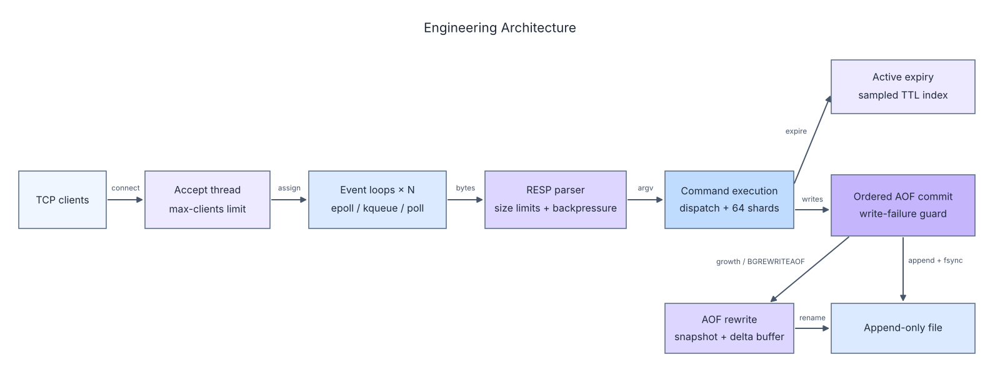
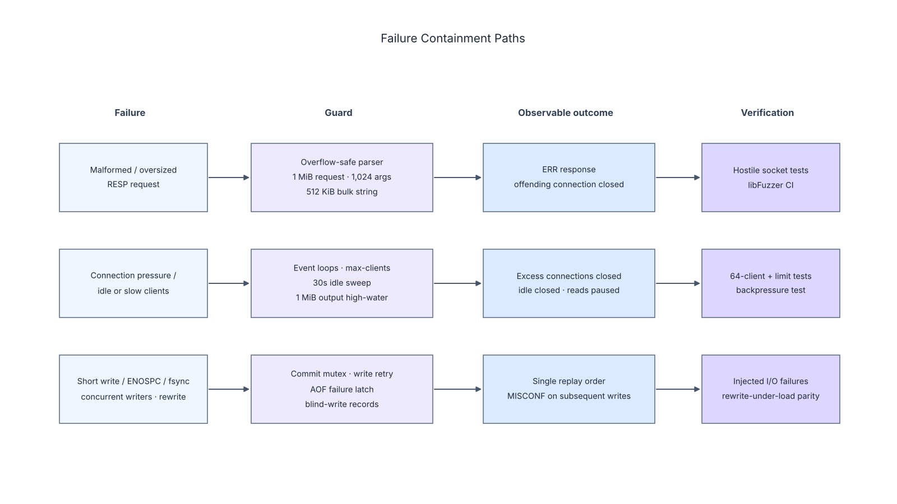

# Mini Redis C++

    <br>
    

A Redis-compatible in-memory key-value server written in C++20. It implements RESP over TCP, command dispatch, sharded storage, TTL expiration, AOF persistence, real-socket integration tests, and a local benchmark client. Supported commands are `PING`, `ECHO`, `SET`, `GET`, `MGET`, `EXISTS`, `DEL`, `EXPIRE`, `EXPIREAT`, `PEXPIREAT`, `TTL`, `INCR`, `DECR`, and `BGREWRITEAOF`; `SET` supports `EX`, `PX`, `EXAT`, `PXAT`, `NX`, and `XX`.

## Architecture



The network layer runs N event-loop threads, each multiplexing many non-blocking connections through `epoll` (Linux), `kqueue` (macOS/BSD), or a portable `poll` fallback. An accept thread enforces a connection limit and hands sockets to loops round-robin. Each connection owns input and output buffers; once 1 MiB of replies is queued the loop stops parsing that client until the socket drains, so a slow reader cannot grow server memory. An idle sweep closes connections that make no progress.

The store hashes keys across 64 shards. Each shard owns an `unordered_map` and a `std::shared_mutex`: `GET` and `TTL` use shared locks, while writes take an exclusive lock only on the target shard. With AOF disabled, writes to different shards run in parallel; with AOF enabled, state-changing commands and their log records share one commit order. Expiration is lazy on access plus Redis-style active expiry that samples a per-shard index of TTL-bearing keys under a time budget, rather than scanning the whole keyspace.

The AOF logs every change as a blind write or an absolute deadline (`SET ... PXAT`, `DEL`, `PEXPIREAT`; `INCR` is logged as the resulting `SET`). That property lets `BGREWRITEAOF` and growth-triggered rewrites snapshot the store shard by shard while writers continue, append the records committed in the meantime, and atomically rename the compact file into place. The AOF supports `always`, `everysec`, and `no` sync policies, startup replay, and corrupt-tail truncation.

Tests cover protocol boundaries, command semantics, concurrency, idle clients, connection limits, output backpressure, absolute-TTL restart behavior, AOF ordering, rewrite under concurrent writes, short writes, `ENOSPC`, and `fsync` failures. Integration tests start a real server process and communicate through TCP sockets. CI runs Release, ASan/UBSan, ThreadSanitizer, and libFuzzer jobs on Linux, the `poll` backend on Linux, and the `kqueue` backend on macOS; `.clang-tidy` is included for local static analysis.



## Build and Test

Requires CMake 3.20+ and a C++20 compiler (GCC or Clang). Linux and macOS are tested in CI.

```bash
cmake -S . -B build -DCMAKE_BUILD_TYPE=Release
cmake --build build
ctest --test-dir build --output-on-failure
```

Sanitizer and fuzzing builds match the CI jobs:

```bash
# AddressSanitizer + UndefinedBehaviorSanitizer
cmake -S . -B build-asan -DCMAKE_BUILD_TYPE=Debug -DMINI_REDIS_ENABLE_SANITIZERS=ON -DMINI_REDIS_BUILD_BENCHMARKS=OFF
cmake --build build-asan && ctest --test-dir build-asan --output-on-failure

# libFuzzer RESP parser target (requires Clang)
CC=clang CXX=clang++ cmake -S . -B build-fuzz -DCMAKE_BUILD_TYPE=Debug -DMINI_REDIS_BUILD_TESTS=OFF -DMINI_REDIS_BUILD_BENCHMARKS=OFF -DMINI_REDIS_BUILD_FUZZER=ON
cmake --build build-fuzz --target miniredis_resp_fuzz
./build-fuzz/miniredis_resp_fuzz -max_total_time=30 -timeout=2
```

Start the server with AOF enabled:

```bash
./build/miniredis_server \
  --port 6380 \
  --workers 4 \
  --max-clients 10000 \
  --idle-timeout-ms 30000 \
  --aof data/appendonly.aof \
  --appendfsync everysec \
  --auto-aof-rewrite-min-size 67108864 \
  --auto-aof-rewrite-percentage 100
```

`--workers` sets the number of event-loop threads (default: one per CPU). The event backend is chosen at build time; `-DMINI_REDIS_POLLER=poll` forces the portable backend.

Example commands:

```bash
redis-cli -p 6380 PING
redis-cli -p 6380 SET name alice NX EX 60
redis-cli -p 6380 GET name
redis-cli -p 6380 INCR visits
redis-cli -p 6380 BGREWRITEAOF
```

## Performance

All numbers below are local loopback measurements on a single machine, reported as the median of five runs. The throughput comparison uses identical client count, pipeline depth, keyspace, and disabled persistence for Mini Redis and Redis 8.4. Results vary with system load and are not cross-machine comparisons.

### Throughput vs. Redis 8.4

Measured with `redis-benchmark`, 16 clients, pipeline depth 16, 500,000 requests per run, and a 100,000-key random keyspace.

| Command | Mini Redis | Redis 8.4 | Relative |
|---|---:|---:|---:|
| `GET` | 384.3k ops/s | 344.4k ops/s | 112% |
| `SET` | 392.5k ops/s | 330.0k ops/s | 119% |

Multiple event loops over the 64-shard store allow independent keys to be served concurrently, while Redis 8.4 executes these commands on its main command thread. The comparison highlights the parallelism available in this loopback workload; it is not intended as a general replacement claim for Redis.

### Latency at low concurrency

Measured with the bundled benchmark client using `PING`, pipeline depth 1, and 100,000 requests per run.

| Clients | p50 | p99 | Throughput |
|---:|---:|---:|---:|
| 1 | 0.088 ms | 0.627 ms | 7.8k ops/s |
| 2 | 0.127 ms | 0.412 ms | 14.2k ops/s |
| 4 | 0.147 ms | 0.471 ms | 23.4k ops/s |

Mini Redis accepts RESP array commands only. Because `redis-benchmark -t ping` begins with an inline `PING`, PING measurements use the bundled RESP benchmark client instead.

### Event loop, expiration, and AOF rewrite

These before/after numbers come from a 2-vCPU Linux VM with Redis 7.0.15 as the reference, so they are separate from the tables above. "Before" is the previous blocking worker-pool build. The pipelined row is the median of six runs; latency rows show the range of three runs.

| Scenario | Before | After |
|---|---:|---:|
| Default `redis-benchmark -t set` (50 clients, no pipeline) | stalls until idle timeout | 92k ops/s, p50 0.26 ms |
| Same, 1,000 clients | stalls | 90k ops/s (Redis 7.0: 102k) |
| Pipelined `SET`, 16 clients, persistence off (Redis 7.0: 713k) | 481k ops/s | 738k (16 loops), 857k (2 loops) |
| `GET` max latency, 2M keys with TTL | 19 to 27 ms | 4 to 5.5 ms (empty-keyspace baseline: 3.5 to 5 ms) |
| AOF after 1M `SET`s over 10k keys | 45 MB, 509 ms replay | 450 KB, 8 ms replay |

The pipelined `SET` gain comes from removing the global commit lock when AOF is disabled. The tail-latency gain comes from replacing the once-per-second full keyspace scan, which held each shard's exclusive lock while it walked every key, with bounded sampling.

### Reproduce

```bash
# Start both servers with persistence disabled for the throughput comparison.
./build/miniredis_server --port 6380 --aof ""
redis-server --port 6379 --save "" --appendonly no

# Run the same workload against Mini Redis and Redis 8.4.
redis-benchmark -p 6380 -t set,get -c 16 -P 16 -n 500000 -r 100000
redis-benchmark -p 6379 -t set,get -c 16 -P 16 -n 500000 -r 100000

# Reproduce a low-concurrency latency point with the bundled client.
./build/miniredis_benchmark --host 127.0.0.1 --port 6380 \
  --requests 100000 --clients 1 --pipeline 1 --command PING
```

Implementation details are documented in [architecture](docs/architecture.md), [persistence](docs/persistence.md), [engineering notes](docs/engineering.md), [benchmark methodology](docs/benchmark.md), and the [roadmap](docs/roadmap.md).
